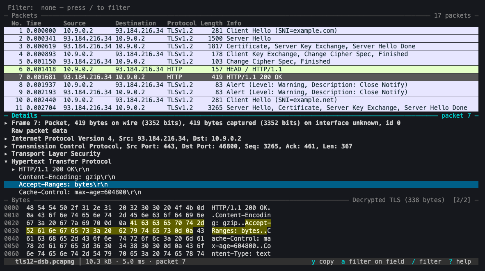

# packetshark

A terminal UI for Wireshark. Packet list, protocol details and bytes in three
panes, with display filters, stream following and statistics, in one small
binary that runs anywhere you have a shell.

packetshark does no dissection of its own. It drives **sharkd**, the JSON-RPC
daemon that ships with Wireshark, so every protocol, display filter, colouring
rule and preference Wireshark has works here, with the same results.



## What it does

- **Three linked panes.** Select a field and its bytes light up; move the byte
  cursor and the field that owns the byte is selected. Reassembled and
  decrypted data appear as extra data sources.
- **Display filters with live feedback.** The filter is checked as you type,
  field names complete with Tab, and an invalid filter is never applied.
- **Large captures.** Only the rows on screen are fetched, so a
  million-packet capture scrolls like a small one (see [Performance](#performance)).
- **Follow Stream** for TCP, UDP, TLS, HTTP, HTTP/2, QUIC and the rest, as
  text, hex dump or raw bytes; save the payload or filter down to the stream.
- **Statistics**: conversations, endpoints, protocol hierarchy, expert
  information, per-protocol trees, and exporting objects (HTTP, SMB, TFTP, ...).
- **Find** by filter expression or plain text; **go to** a packet; **marks**
  and **time references**.
- **Apply or prepare a filter** from any field, and **copy** values, filters
  or bytes to the clipboard (using OSC 52, so it works over SSH).
- **Live capture** through `dumpcap`, a capture **piped in on stdin**, or a
  file that another program is still writing.
- **Your Wireshark profile**: columns, colouring rules and preferences are
  picked up as they are; `-C` selects another profile.
- **Columns on the fly**: press `C` on any field to add it as a column, or
  `:column http.host Host`.
- Mouse support, two layouts, zoom, and a `?` key that lists everything; the
  status bar shows the keys that matter where you are.
- **Works on plain terminals**: ASCII drawing when the locale is not UTF-8,
  no colour when `NO_COLOR` is set, light and dark backgrounds.

## Install

packetshark needs Wireshark's command-line tools. `sharkd` is required;
`dumpcap` is used for live capture and `tshark` for saving filtered packets.

| System           | Command                          |
| ---------------- | -------------------------------- |
| macOS (Homebrew) | `brew install wireshark`         |
| Debian, Ubuntu   | `sudo apt install tshark`        |
| Fedora           | `sudo dnf install wireshark-cli` |
| Arch             | `sudo pacman -S wireshark-cli`   |

Then build packetshark with Rust 1.88 or newer:

```sh
cargo install --path .
```

If `sharkd` is somewhere unusual, point to it with `--sharkd PATH`, the
`PACKETSHARK_SHARKD` environment variable, or `sharkd = "..."` in the config
file.

Wireshark 3.6 and newer work. The test suite runs against 3.6, 4.0, 4.2 and
4.6, which are what Ubuntu 22.04, Debian 12, Ubuntu 24.04 and current
systems ship.

## Use

```sh
packetshark capture.pcapng                    # open a capture
packetshark -Y 'http && ip.addr == 10.0.0.1' capture.pcapng
packetshark -i en0                            # capture live (see below)
packetshark -i en0 -f 'port 53'               # ... with a capture filter
ssh host tcpdump -U -w - | packetshark -      # capture on another machine
packetshark --tail growing.pcap               # follow a file being written
packetshark --keylog keys.log tls.pcapng      # decrypt TLS
packetshark -D                                # list capture interfaces
```

Press `?` inside packetshark for the keys. `packetshark --help` lists the options.

### Live capture permissions

Capturing needs access to the network devices, which packetshark leaves to
`dumpcap` exactly as Wireshark does. Without it you get dumpcap's own error
and a hint:

- macOS: `brew install --cask wireshark-chmodbpf`
- Linux: `sudo usermod -aG wireshark $USER`, then log in again

## Keys

**Everywhere**

| Key               | Action                                          |
| ----------------- | ----------------------------------------------- |
| `?`               | Show or hide this help                          |
| `q`               | Quit (or close the current window)              |
| `Tab / Shift-Tab` | Next / previous pane                            |
| `1 2 3`           | Go to packet list / details / bytes             |
| `/`               | Edit the display filter                         |
| `x`               | Clear the display filter                        |
| `:`               | Command line (try :help)                        |
| `s`               | Find a packet (filter expression or plain text) |
| `n / N`           | Next / previous match                           |
| `z`               | Zoom the current pane                           |
| `L`               | Switch layout (stacked / side by side)          |
| `+ / -`           | Grow / shrink the current pane                  |
| `Ctrl-r`          | Reload the capture                              |
| `Ctrl-c`          | Stop a live capture, or quit                    |

**Moving**

| Key                            | Action                           |
| ------------------------------ | -------------------------------- |
| `j / k, ↓ / ↑`                 | Down / up                        |
| `PgDn / PgUp, Ctrl-d / Ctrl-u` | Page down / up                   |
| `g / G, Home / End`            | First / last                     |
| `Mouse`                        | Click to select, wheel to scroll |

**Packet list**

| Key      | Action                                        |
| -------- | --------------------------------------------- |
| `Enter`  | Go to the details pane                        |
| `m`      | Mark or unmark the packet                     |
| `Ctrl-t` | Set or clear a time reference                 |
| `t`      | Change the time format                        |
| `c`      | Change row colouring (Wireshark / tint / off) |
| `F`      | Follow the packet's stream                    |
| `S`      | Statistics menu                               |
| `:123`   | Go to packet 123                              |

**Packet details**

| Key            | Action                                                 |
| -------------- | ------------------------------------------------------ |
| `Enter, Space` | Expand or collapse; follow a packet link               |
| `l / h, → / ←` | Expand / collapse (or go to the parent)                |
| `*`            | Expand everything under the field                      |
| `e`            | Expand or collapse the whole tree                      |
| `a`            | Apply the field as a filter                            |
| `C`            | Add the field as a column in the packet list           |
| `p`            | Prepare a filter from the field (edit before applying) |
| `y`            | Copy the field (value, filter, bytes, ...)             |

**Packet bytes**

| Key               | Action                                               |
| ----------------- | ---------------------------------------------------- |
| `h j k l, arrows` | Move the byte cursor; the matching field is selected |
| `[ / ]`           | Previous / next data source (reassembled, decrypted) |
| `y`               | Copy bytes                                           |

**Filter bar**

| Key               | Action                                        |
| ----------------- | --------------------------------------------- |
| `Enter`           | Apply                                         |
| `Esc`             | Cancel                                        |
| `Tab`             | Complete the field name                       |
| `↑ / ↓`           | Choose a completion, or browse recent filters |
| `Ctrl-u / Ctrl-w` | Clear the line / delete a word                |

**Follow stream**

| Key     | Action                                           |
| ------- | ------------------------------------------------ |
| `m`     | Change mode (ASCII / hex dump / raw)             |
| `d`     | Show both directions / client only / server only |
| `f`     | Filter the packet list to this stream            |
| `Enter` | Go to the packet at the top of the view          |
| `w`     | Save the payload to a file                       |
| `y`     | Copy the text                                    |

**Statistics**

| Key               | Action                                                  |
| ----------------- | ------------------------------------------------------- |
| `Enter`           | Filter to the row, go to its packet, or save the object |
| `Tab / Shift-Tab` | Next / previous protocol                                |
| `o / r`           | Sort by the next column / reverse the order             |
| `f`               | Count only packets matching the display filter          |

**Commands**

| Key                       | Action                                                        |
| ------------------------- | ------------------------------------------------------------- |
| `:<number>`               | Go to a packet                                                |
| `:filter <expr>`          | Apply a display filter                                        |
| `:clear`                  | Clear the display filter                                      |
| `:conv [proto]`           | Conversations (eth, ipv4, ipv6, tcp, udp)                     |
| `:endpoints [proto]`      | Endpoints                                                     |
| `:phs`                    | Protocol hierarchy                                            |
| `:expert`                 | Expert information                                            |
| `:objects [proto]`        | Exportable objects (http, smb, tftp, imf, ...)                |
| `:stat <name>`            | A protocol's statistics tree (http, http_req, dns, rtsp, ...) |
| `:follow [proto]`         | Follow the selected packet's stream                           |
| `:write <file>`           | Save the displayed packets                                    |
| `:column <field> [title]` | Add a column showing a field                                  |
| `:column remove [name]`   | Remove an added column (all, without a name)                  |
| `:marked`                 | Show only marked packets                                      |
| `:unmark`                 | Remove all marks                                              |
| `:keylog <file>`          | Decrypt TLS with a key log file                               |
| `:set <pref> <value>`     | Set a Wireshark preference                                    |
| `:time <format>`          | relative, delta, absolute, date, utc, utc-date, default       |
| `:colors <mode>`          | wireshark, tint, off                                          |
| `:layout <name>`          | stacked, side                                                 |
| `:open <file>`            | Open another capture                                          |
| `:reload`                 | Reload the capture                                            |
| `:stop`                   | Stop a live capture                                           |
| `:quit`                   | Quit                                                          |

Typing after `/` replaces the current filter; press an arrow key first to
edit it instead.

## Configuration

`~/.config/packetshark/config.toml` (or `$XDG_CONFIG_HOME/packetshark/config.toml`,
or the file named by `PACKETSHARK_CONFIG`). Every key is optional; see
[`config.example.toml`](config.example.toml).

```toml
sharkd = "/opt/wireshark/bin/sharkd"   # default: found automatically
profile = "work"                       # Wireshark configuration profile

[ui]
row_colors = "wireshark"   # wireshark | tint | off
layout = "stacked"         # stacked | side
background = "auto"        # dark | light | auto (used by "tint")
mouse = true
expand_all = false         # start with the details tree fully open
ascii = false              # draw with ASCII only (automatic without UTF-8)
```

Recent filters are remembered in `~/.local/state/packetshark/filters`.

Row colours: `wireshark` paints rows with your colouring rules as the GUI
does. If that clashes with your terminal theme, `tint` colours only the text
and `off` uses none. `c` cycles through them.

Terminals: the interface uses your terminal's own colours for its accents, so
it follows your theme. Set `background = "light"` if a light terminal is not
detected. With a locale that is not UTF-8 (or `--ascii`) it draws with ASCII
characters only, and with [`NO_COLOR`](https://no-color.org) set it uses
bold, dim and reverse video instead of colour.

## Performance

Measured with the release build on an Apple M5 Pro, Wireshark 4.6.9, and a
synthetic capture of 1,000,000 UDP packets (71 MB). To run it yourself:

```sh
PACKETSHARK_PERF_PCAP=big.pcap cargo test --release --test perf -- --ignored --nocapture
```

| Operation                                 | Time        |
| ----------------------------------------- | ----------- |
| Open (load and first screen)              | 4.6 s       |
| Move to the next packet, details included | under 50 ms |
| Jump to the last packet                   | under 50 ms |
| Apply a filter for the first time         | 5.4 s       |
| Apply a filter sharkd has seen before     | under 50 ms |
| Jump within a filtered list               | under 50 ms |

| Memory                                                 |              |
| ------------------------------------------------------ | ------------ |
| packetshark with the capture open                      | 5 MB         |
| sharkd with the capture open                           | about 0.9 GB |
| packetshark showing a table of 1,000,000 conversations | 120 MB       |

The slow steps are sharkd dissecting every packet: on load, and the first
time a filter is evaluated. The interface stays responsive while it works.
Statistics tables keep the 100,000 busiest rows and say when they have
dropped the rest.

## How it works

```
 keys, mouse ─▶ App ◀── replies ── worker thread ◀──▶ sharkd  (JSON-RPC over a pipe)
                 │                       ▲
                 └── requests ───────────┘            dumpcap ─▶ spool file (live capture)
```

- `src/sharkd/` is a small blocking JSON-RPC client and a worker thread that
  owns the sharkd process. Replies are parsed straight off the pipe into their
  final types. Requests that a newer one has made pointless (the details of a
  packet the cursor already left) are dropped before they reach sharkd. If
  sharkd crashes, it is restarted, the capture is reloaded and the request is
  retried once.
- `src/app/` is the application state. It consumes events and never touches
  the terminal, which is what lets the test suite drive the real app.
- `src/ui/` draws the state into a [ratatui](https://ratatui.rs) buffer.
- Live captures are written by `dumpcap` to a temporary file that packetshark
  reloads as it grows, backing off as reloads get slower.

## Limitations

- **Live capture reloads the whole file** each time it grows, because sharkd
  has no incremental load. That is fine for minutes of ordinary traffic and
  gets slower as a capture reaches hundreds of megabytes. For long sessions,
  capture to a file and open it afterwards.
- **Unix only so far.** It is developed on macOS and tested on macOS and
  Linux. Windows is untested, and Wireshark's Windows installer does not
  include sharkd.
- **Older Wireshark has less to offer.** Protocol hierarchy statistics need
  4.2 and time references need 4.0; packetshark says so when you ask for
  them. Before 4.2 the delta times in the details pane are relative to the
  previous packet in the file even when a filter hides it.
- **Added columns last for the session.** Columns you want every time belong
  in your Wireshark profile, which packetshark reads.
- Live capture was verified with a scripted stand-in for dumpcap, not against
  a real interface. TLS decryption is covered only by the optional
  real-capture walk (a capture with embedded secrets), not by the default
  test suite.
- No packet editing, no I/O graphs, no VoIP or RTP analysis yet.

## Development

```sh
cargo test                                   # unit tests plus end-to-end tests
cargo clippy --all-targets -- -D warnings    # lints; the set is in Cargo.toml
cargo fmt                                    # Rust formatting (rustfmt.toml)
npx prettier@3 --write "**/*.{md,yml,yaml}"  # Markdown and YAML formatting
npx @taplo/cli@0.7 fmt                       # TOML formatting
```

CI runs all five and fails on any difference.

The end-to-end tests run the real app against sharkd and render it to an
in-memory terminal. They build their own capture files, so they need no
fixtures, privileges or network, and they are skipped when Wireshark is not
installed. `tests/docs.rs` fails if the key reference above drifts from the
in-app help.

`tests/monkey.rs` throws random keys, mouse events, pastes and resizes at the
app and fails if it panics or stops responding. The default run is short;
`PACKETSHARK_MONKEY_EVENTS=20000 cargo test --test monkey` runs for longer.

Two more tests are opt-in because they need files that are not in this
repository:

```sh
# Timings and memory on a large capture
PACKETSHARK_PERF_PCAP=big.pcap cargo test --release --test perf -- --ignored --nocapture

# Walk every packet of real captures (for example Wireshark's test/captures):
# details, bytes, follow, statistics, filters; fails on any error
PACKETSHARK_REAL_DIR=captures/ cargo test --release --test real -- --ignored --nocapture
```

## Credits and licence

packetshark follows the path cut by [termshark](https://github.com/gcla/termshark)
by Graham Clark, which showed how good Wireshark in a terminal can be.

MIT licensed; see [LICENSE](LICENSE). packetshark is not affiliated with the
Wireshark project. It runs Wireshark's tools as separate programs and links
none of Wireshark's code.
